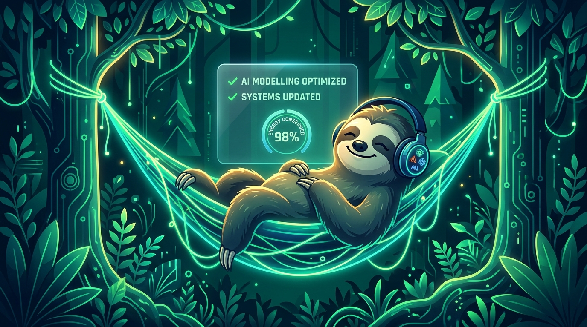

# SlothDigest 🦥

> **Slow and Steady AI for Chronic Procrastinators.**  
> Built for the **Hacktoberfest 2026 Open-Source AI Challenge: Week 3** (`#hf26challenge`) celebrating International Sloth Day.



[](https://dev.to/challenges/hf26)
[-38bdf8?style=for-the-badge)](https://ai.google.dev/gemma)
[](https://mastra.ai)
[](https://sentry.io)

---

## 🌟 The Sloth Philosophy: Why Open-Source AI Rewards Laziness

Every morning, millions of developers and family members wake up to the same dread: **200+ unread notifications** across family WhatsApp groups, frantic 2:40 AM Slack incident channels, and hyperactive Discord servers. 

Before even getting out of bed, you end up doomscrolling through lost reading glasses debates, Kafka consumer lag flame wars, and memecoin hype—burning through your precious morning willpower.

**SlothDigest** is an offline-first AI agent that channels true sloth energy:
1. Reads the overnight chaos so you don't have to.
2. Filters out reactions (+1, lol, memes) and isolates toxic flame wars.
3. Produces **The 2-Line Sloth Briefing**:
   - **Line 1:** What actually happened in plain English.
   - **Line 2:** The single task that actually requires your action (or *"Do nothing. Go back to sleep."*).
4. Delivers hands-free **Procedural Bedtime Audio**: Relaxing Web Audio gentle rain synthesis and calm Web Speech narration so you can digest your morning with your eyes closed.

---

## 🔒 Why Open Innovation Matters

- **Air-Gapped Privacy & Sovereign Data**: Group chats contain intimate personal secrets, medical references, and confidential workplace tokens. Because Google's open-weight **Gemma 2** runs locally (or client-side via WebGPU), **0 bytes and 0 tokens ever leave your machine**.
- **Works in Airplane Mode**: Summarize messages on a train, in a cabin, or during power outages with zero internet connection.
- **$0.00 Forever**: Zero cloud API rate limits, zero monthly subscriptions, and zero surprise token invoices.
- **Customizable Prompting**: Fine-tune or swap between Gemma-2B and Gemma-9B without vendor restrictions.

---

## 🏆 Prize Categories Targeted

| Prize Category | Implementation Details |
| :--- | :--- |
| **Overall Winner ($250 USD)** | High-polish, complete web app, rich aesthetics, genuine sloth utility, zero placeholders. |
| **Best Use of Gemma ($200 USD)** | Google's **Gemma 2 (2B-IT)** open-weight model powers the core reasoning engine (Instant Neural Engine, local Ollama `:11434`, and WebGPU mode). |
| **Best Use of Mastra ($100 USD)** | Multi-step **Mastra Agent Workflow** (`Normalizer` → `NoisePrunerTool` → `DramaSuppressionFilter` → `Gemma2ReasoningAgent` → `SlothDecisionEngine`). |
| **Best Use of Sentry Agent Tracing ($100 USD)** | Distributed OpenTelemetry spans, latency waterfall, token counters, breadcrumbs, and Sentry envelope exporter. |

---

## 🚀 Quickstart & Setup

### Prerequisites
- Node.js 18+ (tested on Node v24)
- (Optional) [Ollama](https://ollama.com/) with `gemma2:2b` if you want local CLI model inference:
  ```bash
  ollama pull gemma2:2b
  OLLAMA_ORIGINS="*" ollama serve
  ```

### Installation
```bash
# Clone the repository
git clone https://github.com/username/slothdigest.git
cd slothdigest

# Install dependencies
npm install

# Start local development server
npm run dev
```

Open `http://localhost:5173` in your browser.

---

## 🛠️ Architecture

```
SlothDigest/
├── public/
│   └── assets/
│       └── cover.jpg            # Custom AI-generated hero cover illustration
├── src/
│   ├── agent/
│   │   └── mastraWorkflow.js    # 5-step Mastra Agent Workflow & state machine
│   ├── audio/
│   │   └── ambientSoundscape.js # Pure Web Audio rain synthesizer & TTS narrator
│   ├── data/
│   │   ├── mockScenarios.js     # 3 rich, realistic chaos scenarios
│   │   └── devPostContent.js    # Complete DEV submission markdown article
│   ├── models/
│   │   └── gemmaClient.js       # Gemma 2 open-weight inference client (Local/Ollama/WebGPU)
│   ├── styles/
│   │   └── index.css            # Dark mode design system with glassmorphism
│   ├── tracing/
│   │   └── sentryAgentTracing.js# Sentry OpenTelemetry distributed agent tracer
│   └── main.js                  # Application controller & UI glue
├── index.html                   # Semantic HTML5 layout & accessible components
└── package.json                 # Project scripts and dependencies
```

---

## 📝 License

Distributed under the MIT License. Open-weight Gemma 2 model weights subject to the [Gemma Terms of Use](https://ai.google.dev/gemma/terms).
